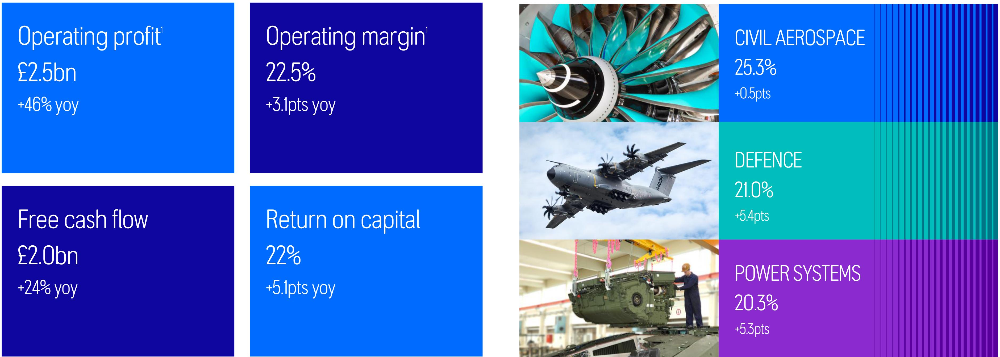

ＲＯＬＬＳR ROYＣE 

# HALF YEAR RESULTS 2026

The information in this document is proprietary and confidential to Rolls-Royce and is available to authorised recipients only – copying and onward distribution is prohibited other than for the purpose for which it was made available.

## STRONG OPERATIONAL AND FINANCIAL PERFORMANCE 

DIVISIONAL OPERATING MARGIN 

KEY GROUP FINANCIAL METRICS 

ROLLS R ROYCE 

1 Operating profit and operating margin shown on an underlying basis 

© 2026 Rolls-Royce. Not Subject to Export Control 

5

## 2026 HALF YEAR UNDERLYING [RESULTS 

<html><body><table border="1"><tbody><tr><td>Underlying results Em</td><td>H1 2026</td><td>H1 2025</td><td>Organic Change'</td><td>Organic Change %1</td></tr><tr><td>Revenue</td><td>11,279</td><td>9,057</td><td>2,310</td><td>26%</td></tr><tr><td>Gross profit</td><td>3,397</td><td>2,572</td><td>839</td><td>33%</td></tr><tr><td>Gross margin %</td><td>30.1%</td><td>28.4%</td><td>1.6pts</td><td></td></tr><tr><td>Operating profit</td><td>2,534</td><td>1,733</td><td>796</td><td>46%</td></tr><tr><td>Operating margin %</td><td>22.5%</td><td>19.1%</td><td>3.1pts</td><td></td></tr><tr><td></td><td></td><td></td><td></td><td></td></tr><tr><td>pence</td><td>H1 2026</td><td>H1 2025</td><td>Change</td><td>Change %</td></tr><tr><td>Basic earnings per share</td><td>22.17</td><td>15.74</td><td>6.43</td><td>41%</td></tr><tr><td>Dividend per share</td><td>6.0</td><td>4.5</td><td>1.5</td><td>33%</td></tr><tr><td></td><td></td><td></td><td></td><td></td></tr><tr><td>Em</td><td>H1 2026</td><td>H1 2025</td><td>Change</td><td></td></tr><tr><td>Free cash flow</td><td>1,964</td><td>1,582</td><td>382</td><td></td></tr><tr><td>Net cash</td><td>2,136</td><td>1,084</td><td>1,052</td><td></td></tr><tr><td>Return on capital</td><td>22.0%</td><td>16.9%</td><td>5.1pts</td><td></td></tr></table></body></html>

Strong results - double-digit profit and cash growth across every division 

Operating profit growth of £0.8bn and free cash flow growth of £0.4bn 

Resilient balance sheet-net cash of £2.lbn Interim dividend of 6.0p per share 

Best-in-class return on capital demonstrates significant value creation 

ROLLS R ROYCE 

1 Organic change is the measure of change at constant translational currency applying half year 2025 average rates to 2025 and 2026 and excludes M&A and business closures. All underlying income statement commentary is provided on an organic basis unless otherwise stated 

© 2026 Rolls-Royce. Not Subject to Export Control 

9