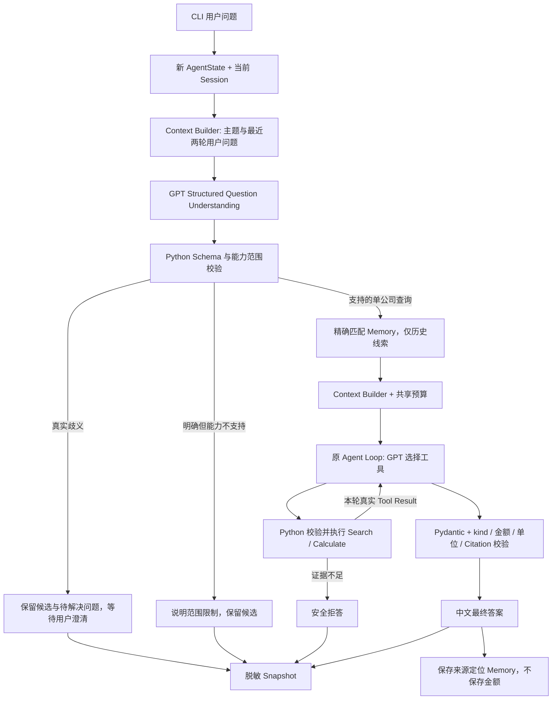

# Financial Research Agent

统一入口为 `financial_agent.py`。原有 `demo.py`、`api_demo.py` 和各课 Demo
继续保留。所有入口复用已有 `search_report()`、`calculate()` 和财务校验逻辑。

## Final Integration：先从这里运行

在本目录的 PowerShell 中运行：

```powershell
# 安全默认：四轮固定示例；Fake Responses + 真实本地 Retrieval，无 API、无费用
.\.venv\Scripts\python.exe -B -X utf8 financial_agent.py --demo

# 交互式离线示例，输入 exit 退出
.\.venv\Scripts\python.exe -B -X utf8 financial_agent.py

# 全部离线测试
.\.venv\Scripts\python.exe -B -X utf8 -m unittest discover -q

# 完整 8 场景 / 11 轮离线评估器检查
.\.venv\Scripts\python.exe -B -X utf8 -m evaluation.final_runner
```

默认交互模式只接受代码中公开列出的固定示例。这是 Fake Responses 接线演示，
不是 Python 模拟自然语言理解，也不会因不认识输入而偷偷调用 API。
四轮示例依次询问 2025 Q2 营收、去年同期、模糊的同比追问，再明确比较期间；
预期得到 98.9、91.2、期间澄清、+7.7（单位：十亿美元）。

以后明确批准付费后，可用同一入口连续输入自然语言：

```powershell
# 仅供批准后手动运行；本次整合没有执行
.\.venv\Scripts\python.exe -B -X utf8 financial_agent.py --live --confirm-paid-api
```

Live 固定 `gpt-6.1-sol`，SDK `max_retries=0`、timeout 30 秒；
只在上述两个开关同时提供时读取 `OPENAI_API_KEY`，不打印密钥。
GPT 负责理解公司、指标、期间和追问，选择工具及最终结构化字段；
Python 负责预算、类型/范围校验、执行工具、证据核对与中文答案渲染。
原来的 Rule-based Parser 留在 `session_demo.py`，统一入口不会调用它。

### Architecture



### 三种情况的区别

- `ambiguity`：例如已有 CVS 和 UNH 候选，却问“那家公司”。GPT 应请求明确指代，
  Python 保留 `pending_companies` 和 `pending_question`，不执行财务工具。
- `insufficient_evidence`：例如 Amazon 2025 Q2 或 CVS 2023 Q2 的营收查询。
  问题属于支持的查询类型，但当前本地资料无法验证；Search 后 Python 拒答，不能借用旧金额。
- `unsupported_capability`：例如明确同时查 CVS 和 UNH、查询净利润、同比百分比、跨季度比较。
  双公司问题不是天然的语言歧义；当前单公司工具缺少分析能力。保存候选和期间，用户明确选择
  一家公司后才创建新任务继续；本阶段不增加多公司工具。

支持的已验证财务范围：CVS 2025 Q2、2024 Q2 合并总营收；2025 Q2 相比 2024 Q2 的增加金额。
未知公司/期间可以进入 Search，但不承诺存在资料。纯算术的旧 `api_demo.py --scenario calculate`
仍保留；统一自然语言入口目前只接收财报查询及同比增加金额。
不支持百分比、其他指标、多公司回答、自动下载财报、交易、自动恢复任务或长期对话记忆。

### State、存储与错误控制

- 每题独立 AgentState；Session 只保留最近两轮和当前主题/待解决问题。
- Question Understanding 和财务 Agent Loop 共用每题预算：最多 4 次请求、12000 Tokens、
  5 次工具调用；每次最多 1024 Output Tokens。
- 整个 CLI 进程共享最多 32 次请求、30000 Tokens，跨题不重置。
  API 返回的 Usage 另行累计；UTF-8 字节估计只是保守的请求前检查。
  任何 API、预算、Schema、工具或存储异常都会停止当前 Session，不自动重试。
- Snapshot 在 `artifacts/financial_agent/snapshots`；Memory 在同级 `memory`，均被 Git 忽略。
  只存标准化查询、已验证公开答案、计数、状态/失败阶段和来源定位；不存用户原文、完整对话、
  财报正文、原始 API 异常或模型隐藏推理。澄清正文也不写入 Snapshot。
- Memory 默认最多返回 3 条、1800 字符；7 天后标过时，任何年龄都必须重新核实。
  同主题最多 20 条，满额安全停止写入，不自动删除旧记录。
- Snapshot 与 Memory 分别原子写入，不是跨文件事务：Memory 写失败时可能已有合法 Snapshot。
  CLI 会报告保存失败并停止；不会回放工具。读取 Snapshot 不等于恢复执行。
- 失败时已成功的 Tool Call 记录保留在内存；安全诊断沿用原最终校验逻辑。
  Snapshot 仅保留失败阶段，不持久化工具原始参数。可用已有 `load_state_snapshot()` 读取。

### 固定版本最终评估

冻结集 `financial_research_v1`（18 场景）和 `llm_live_development_v1`（8 场景 / 11 轮）不变。
完整真实评估将用后者；前者及全部 Unit Tests 仍做离线回归。
Final Runner 调用与 CLI 相同的 `integrated_turn()`，每案例独立 Session/存储，
同案例内连续提问并共享 Memory。每轮记录真实理解结果、工具、引用、错误及 Usage。

整合稳定后创建**本地 Feature Branch Commit**，再执行：

```powershell
.\.venv\Scripts\python.exe -B -X utf8 -m evaluation.final_runner --freeze
# 批准真实评估后才执行：
.\.venv\Scripts\python.exe -B -X utf8 -m evaluation.final_runner --live --confirm-paid-api
```

当前冻结记录位于 `artifacts/evaluation/final_integration_v2/frozen_version.json`；v1 原样保留。
记录包括 Commit Hash、全部运行源码哈希、工具定义与哈希、Retrieval 输入及其 Python 依赖代码、
SDK/Pydantic/Python/tiktoken/markdown-it-py 版本、模型配置、预算及
Dataset/Suite 版本。付费模式在读取密钥前验证工作区干净且冻结记录完全匹配。
修改后不能偷偷沿用旧冻结版本；不会覆盖已有冻结记录和历史报告。

工具返回值在进入 State 或发送给 GPT 之前，检查两期金额的有限十进制字符串格式，
以及单位、Citation、来源标题、页码与 URL；字段损坏安全停止。金额仍由原有本地表格解析器提取，
不会从评估 Golden Labels 读取。最终答案继续与本轮工具结果核对。
完整回归中的历史重测/剩余轮次选择测试使用临时合成历史，不依赖被 Git 忽略的真实评估报告。
`gpt-6.1-sol` 是官方当前提供的模型标识，本项目不能冻结服务端权重；记录同一模型名和配置
并不保证不同日期的输出完全一致。Fake Responses 通过也不证明真实 GPT 的语义理解质量。

预期约 28 次请求，硬性程序上限 32 次；每题最多 4 次，累计 Token Budget 30000，
单次最多 1024 Output Tokens。按已核对 Standard 输入 $2 / 1M、输出 $10 / 1M，
规划费用约 $0.05–$0.10；若所有预算 Tokens 都按 $10 / 1M 计算，保守预算估算约 $0.30。
这不是学校账单的服务端美元硬限额；无 Usage 的失败请求成本未知。
定价来源：https://developers.openai.com/api/docs/models/gpt-6.1-sol （2026-11-10 核对）。

**重要标签差异**：L05 的冻结 gold 是 `clarify`，新程序将明确双公司问题标为 `unsupported`。
原始评分继续显示这项不匹配，不能修改标签来提高分数；报告单列当前能力范围审查。
这套题是已见过的开发/回归集，不是独立 Out-of-sample Test。Fake Responses 分数只证明
调用与评分接线，不能证明 GPT 能力；新固定版本的真实分数必须另行付费验证。

以下保留各阶段教学说明；其中的测试数量和模式说明属于当时版本。

## 运行

在本目录的 PowerShell 中执行。项目已创建独立的、本地忽略的 Python 环境。

```powershell
.\.venv\Scripts\python.exe -B -X utf8 api_demo.py
.\.venv\Scripts\python.exe -B -X utf8 api_demo.py --scenario search
.\.venv\Scripts\python.exe -B -X utf8 api_demo.py --scenario calculate
.\.venv\Scripts\python.exe -B -X utf8 api_demo.py --scenario insufficient
.\.venv\Scripts\python.exe -B -X utf8 -m unittest discover -v
```

新电脑可用 `python -m venv .venv`，然后执行
`.\.venv\Scripts\python.exe -m pip install -r requirements-openai.txt` 安装依赖。
需要同仓库中已有的 Chunking 索引与公开 CVS 来源元数据。

## Agent Loop

1. Python 把固定场景问题和两个 Tool Definitions 交给模型。
2. 模型返回 `function_call`，选择工具名称及参数。
3. Python 核对名称、参数、数字依据，执行对应的现有函数。
4. Python 用同一个 `call_id` 创建 `function_call_output`，连同之前的
   模型输出送回模型。Reasoning items 也保留在对话中。
5. 模型选择结束时，返回结构化的答案类型、数值、单位、Citation。
   Python 先用 Pydantic 检查结构，再对照真实工具结果校验，最后渲染中文答案。

为使 Citation 和数字可以可靠核对，这版支持四个固定问题。
答案句子由 Python 模板生成。真实模型负责选择工具、参数和最终答案字段。
通用财务问答需要后续扩大检索与答案校验范围。

## Agent State

`AgentState` 把一次任务的信息集中保存在内存中。现有 `run_agent()`
仍返回答案字符串；调用者可传入一个新的 State，以便在成功或失败后查看任务进度。

```python
from api_demo import AgentState, StopAgent, run_agent
from mock_responses import MockClient

state = AgentState()
try:
    answer = run_agent(MockClient("compare"), state=state)
except StopAgent:
    print(state.failure_stage, state.error)
print(state.status, state.api_request_count, state.tool_call_count)
print(state.input_tokens, state.output_tokens, state.total_tokens)
```

- `user_question` 和 `history` 保存问题、成功调用、工具结果和通过校验的最终模型消息。
- `evidence` 保存营收和 Citation，`calculation` 保存计算结果。
- `api_request_count` 在发请求前增加，因此失败请求也计数。
- `tool_call_count` 延续原有轮数含义，在解析、执行调用前增加，包含失败的尝试。
- Token 字段累计 API 已返回的 Usage。失败请求没有返回 Usage 时，计数代表已知用量。
- `status` 从 pending 变为 running，结束时为 completed 或 failed。
- `stage` 标识当前阶段，`pending_tool_call` 在执行前记录工具名、参数和 call_id。
- 成功后清空 pending 调用；失败时保留它，以及之前成功的历史和证据，
  并记录 `failure_stage` 与安全错误信息。外部异常正文会被隐藏。
- `final_answer` 保存通过校验的答案。“证据不足，无法回答”也属于正常完成的结果。

每次任务使用新的 State。调用者持有的对象在函数报错后仍可查看，
进程退出后这些内存数据就会消失。
State 中只放任务数据，API Client、环境变量和 HTTP 凭据不进入 State。

在 CVS compare 的 Fake Responses 中，检索成功后为 1 次请求、1 次工具调用、
120 total tokens；计算成功后为 2 次请求、2 次工具调用、240 total tokens；
答案通过校验后为 3 次请求、2 次工具调用、360 total tokens，
其中 input 300、output 60。这些 Usage 数字由离线模拟响应提供。

## 内存 Session 与连续追问

新增 `session_demo.py`。它只使用 Fake Responses 和原有真实本地工具，没有 Live 选项，
不读取 API Key、不保存 Session，也不自动读取或写入 Snapshot。

```powershell
# 自动运行目标中的两轮对话，并打印 Tool Call、结果、State 和 Session 摘要。
.\.venv\Scripts\python.exe -B -X utf8 session_demo.py

# 在同一个进程中亲自追问；输入 exit 退出。
.\.venv\Scripts\python.exe -B -X utf8 session_demo.py --interactive
```

第一问“CVS 2025 Q2 的合并总营收是多少？”会建立主题：CVS、合并总营收、2025 Q2。
第一轮独立的 AgentState 执行 Search，得到简报中的 98.9 十亿美元及第 6 页 Citation。
第二问“那比去年增长了多少？”从 Session 继承公司、指标和期间，上一年由 `year - 1`
计算，因此生成 2025 Q2 对比 2024 Q2 的完整查询。它创建另一个 AgentState，
重新执行 Search 后再执行 Calculate，得到约增加 7.7 十亿美元（按简报四舍五入数值计算）。

- `Session` 保存当前公司、指标、年份、季度以及 `deque(maxlen=2)` 最近两轮完整问答。
  每轮只保存问题、补全后的问题、回答、任务 ID 和结果类型，不持有 AgentState 或工具历史。
  问题最多 300 字，保存的回答最多 1,500 字；更早的问答自动移除。
- `resolve_question()` 使用小范围 Python 规则解析句子，明确写出的字段更新主题，
  省略字段继承主题。“去年”相对正在讨论的年份，不相对电脑时间。
- `ResearchQuery` 根据这些字段动态生成中文问题和英文检索查询。
  追问没有固定映射回 CVS 2025 Q2；公司、年份和季度变化会改变实际查询。
- `run_turn()` 为每个输入创建新 State，向原有 `run_agent()` 传入可选的查询条件。
  每次请求前由 `build_context()` 选出补全后的当前问题、确认主题、必要纠正和本任务工具记录，
  最多附加一份相关旧主题摘要，不复制前一任务 History 或回答金额。
- 缺少条件或句式不明确时返回澄清提示，不发模拟请求、不调用工具。
  这时任务 State 保持 pending，Session 中该轮的 outcome 为 clarification。
  完整且明确的字段可以先保留，例如先问“CVS 2025 Q2 呢？”，再补充“合并总营收是多少？”。
- 已确认的公司或期间即使缺少财报证据，也会成为当前主题；不会偷偷退回上一家公司。
  超出证据范围时最终回答为“证据不足，无法回答”。
- 单任务的 5 次工具调用、6 次请求、12,000 累计 tokens 和 1,024 单次 output tokens 上限不变。
  每个新问题单独计数。这一离线 Session 没有跨任务的费用预算；接入 Live 前还需加入会话预算。

支持的输入示例：

- `CVS 2025 Q2 的合并总营收是多少？`
- `那比去年增长了多少？`（本 Demo 明确解释为同比增加金额）
- `那 2024 Q2 呢？`（明确切换期间，重新 Search 得到 91.2 十亿美元）
- `那 UNH 呢？` 或 `UNH 2025 Q2 的合并总营收是多少？`（切换公司，但当前资料不足）

公司用 1–10 位英文字母 Ticker；另识别 CVS Health、联合健康、苹果、Amazon 和亚马逊别名。
期间使用完整的 `2025 Q2` 格式。不明确的“之前”“今年”、多个公司或多个期间、未知句式、
未支持的指标、增长率或环比都会要求澄清。“营收”仅在已明确合并总营收口径后可作简称。

可复用的部分是 Session/任务分离、字段继承、按上一年补全期间、有限历史和每轮重新核实证据。
教学限定是中文规则句式、单一指标、Fake 模型决策，以及原有 Retrieval 只提取 CVS 2025/2024 Q2。
`search_report()` 本身仍是 CVS 专用检索，即使 UNH 查询返回了 CVS Chunk，也会被外层范围检查拒绝。
因此切换公司意味着正确更新查询和停止无依据回答，不代表已经支持其他公司的财报分析。

原有 Mock Demo、Structured Outputs、Evidence Validation、Snapshot 格式和生产检索均保留。
新增离线测试覆盖两轮追问、公司/期间切换、重新检索、歧义与缺失字段、Session 隔离、
有限 History、证据不足、预算停止和伪造最终结果。

## 确定性 Context Builder

`context_builder.py` 的 `build_context()` 每次在模型请求前执行，返回 `ContextPlan`：

- `decision`：ready、clarify、budget_stop 或 invalid_context。
- `input_items`：本次实际要发送的输入；不能发送时为空列表。
- `estimated_input_tokens`：完整请求的保守输入估算。
- `selected_task_ids`：选中哪一轮旧主题摘要，仅用于本地解释。
- `omitted`：哪些内容被过滤或因预算删除。
- `message`：需要澄清或安全停止时的固定说明。

它是确定性 Python 选择规则，不调用 LLM 来理解、总结或生成历史。
原有的 Session 规则负责补全当前问题；Context Builder 负责选择模型能看到的材料。

必需材料包括：已确认公司/指标/期间、仍适用于当前主题的用户纠正、补全后的当前问题、
本任务完整的模型 Response Items 和工具结果。相关旧历史只选最近一个公司/指标/期间
完全匹配的已完成轮次，投影为主题和意图（search/compare）；这是可以删除的可选摘要。
旧问题原文、旧答案、金额、Citation 和旧任务工具记录均不复制。
主题信息标注 `not_financial_evidence`，以普通 user 数据消息置于当前问题前，
不会被提升为系统指令。模型请求还携带原有 INSTRUCTIONS、Tool Definitions 和输出 Schema。

Session 新增 `pending_companies` 和 `latest_correction`，仍只在内存中保留。
如先讨论 Amazon，再问“它和 UNH 哪家营收更高？”，会记录 AMZN、UNH 两个候选，
拒绝后续含糊的“那家公司”。只有明确指定公司后才清除候选。
`我是说 UNH 2024 Q2 的合并总营收是多少？` 和 `更正为 ...` 是支持的纠正句式。
纠正只保存已解析的公司/指标/期间；不接受用户声称的金额作为财报证据。
切换到其他主题时，不再携带旧主题的纠正。其他未识别句式仍请求澄清。

`build_context()` 不修改 Session、AgentState、Evidence 或原始 History。
工具轨迹检查要求初始问题正确、每个 call_id 唯一、调用先于结果、结果与调用匹配，
且没有未完成的调用。保持每轮一个工具的原有限制；缺失、乱序、重复或孤立记录都停止。
合法的 assistant messages 和 reasoning items（包括 encrypted_content）按原样保留，
不把它们压缩成新的工具记录。预算不足时也不会拆散本任务轨迹。

Context Budget 默认上限为 12,000 个保守估算单位，可在调用时调小：

```python
run_turn(session, question, context_budget=5000)
```

估算复用原有 `UTF-8 请求字节数 + 1024`，包括工具定义、Schema 和其他请求字段，
不是实际 tokenizer 计数，也不是模型 Context Window 的官方大小。
同时检查 `已用 tokens + 估算输入 + 最大输出 <= 原有任务 Token Budget`。
超限先移除可选旧主题摘要，再检查；必需内容仍超限就停止，且不会增加请求次数。
每任务 5 次工具调用、6 次请求、12,000 累计 tokens、1,024 单次 output 上限保持不变。
实际 Usage 的累计与超限检查、Structured Outputs 和 Evidence Validation 继续由原有 Loop 执行。

运行以下演示，可看到 Session、每次 ContextPlan，以及和 Fake Responses 请求一致的完整 input：

```powershell
.\.venv\Scripts\python.exe -B -X utf8 context_demo.py
```

演示从 CVS 查询和同比计算，切换到 UNH，再纠正期间，最后切换到 Amazon，并展示歧义澄清。
CVS 能从真实本地检索得到证据；UNH 和 Amazon 没有当前工具支持的证据，返回“证据不足”。
模型标签虽然显示 gpt-6.1-sol，全部响应仍来自 Fake Responses，没有创建 Live Client。
本入口只输出到终端，不保存对话，也不读取 Snapshot。

离线测试验证实际请求 input 等于 ContextPlan、旧金额隔离、相关与无关历史选择、
必要纠正保留、可选摘要裁剪、必需内容超预算停止、多公司歧义、工具配对与 Response Items 保留。

## 本地 Long-term Memory

`long_term_memory.py` 提供 Pydantic `MemoryRecord`、`save_memory()` 和 `search_memory()`。
记录只包含 Schema Version `"1"`、公司、指标、年份/季度、来源 URL/页码、UTC 最后核对时间、
关联的 Snapshot Task ID。不保存金额、完整答案、聊天正文、工具调用或指令文本。
默认保存到 Git 忽略的
`artifacts/research_memory/<company>/<metric>/<year>Q<quarter>/<snapshot_task_id>.json`。
同一主题的不同任务分别保存；同一任务再次保存只原子替换它自己的文件。

Snapshot 的严格 JSON 读取和原子写入已提取到 `json_storage.py`，Memory 与 Snapshot 共用。
Snapshot 原有文件格式仍是版本 `"1"`。公共存储层拒绝重复 JSON 字段、损坏/过大的文件，
并通过各自的 Pydantic 模型检查版本、字段和类型；写入仍采用同目录临时文件、flush、fsync、
关闭文件和 `os.replace()`。错误不回显文件内容或底层异常。

`search_memory(company, metric, year, quarter)` 只访问完全匹配的主题目录，
不使用 Embeddings、向量检索、模糊推断或在线请求。它不读取关联 Snapshot，也不恢复任务。
读取后的每条记录包装为 `context_kind="historical_context"`，并始终设置
`requires_revalidation=true`。超过或等于 7 天标为 `is_stale=true`；未来时间也标为过时，
原因是时间记录可疑。7 天是教学用规则，不代表财报经过 7 天一定失效；近期记录也不保证仍然正确。

为了保证读取有界：每个文件最多 4 KiB，同一主题最多 20 条记录，单次最多读取 20 个文件，
返回最多 3 条。优先返回未过时记录，其次按核对时间从新到旧排序，同时间按 Task ID 排序。
同一主题超出容量会明确停止，不自动删除旧记录。损坏的匹配记录会停止查询，不悄悄忽略损坏。
其他公司的目录不会被读取，所以 CVS 文件损坏不影响查询一个尚不存在的 UNH 主题。

Memory 集成为显式选项，原有 Session 默认仍然不读写长期记录：

```python
from long_term_memory import MEMORY_DIR

result = run_turn(session, question, memory_directory=MEMORY_DIR)
```

新任务只查询一次 Memory，然后把历史匹配交给每次请求前的 Context Builder。
Builder 再次核对主题、字段和历史标记，只加入最多 3 条、序列化后不超过 1,800 字符的历史记录。
超过文本限制会丢弃整条记录，不截断 URL 或标记；超出 Context/任务预算时删除可选历史，
不拆散本任务的 Tool Call/Tool Result。`ContextPlan.memory_task_ids` 显示实际选中的历史任务。

Memory 始终以普通参考数据进入 Context，不提升为系统指令、不执行其中的 URL，
也不复制到 `AgentState.evidence`。Schema 不接受 `instructions`、金额或任意聊天字段。
Schema 校验不等于来源真实性验证：即使有人修改出格式合法的历史记录，它也不能直接成为财务依据。
新任务需要金额时仍使用现有真实 `search_report()`、参数检查、Structured Outputs 和 Evidence Validation。
API 请求次数和 Token 上限保持原样；Memory 查询本身不发 API 请求。

### 跨进程离线演示

在本目录的 PowerShell 依次运行，每个命令都是新的 Python 进程：

```powershell
# 进程一：Fake Responses + 本地真实检索；保存 Snapshot 和 CVS 主题 Memory，随后退出。
.\.venv\Scripts\python.exe -B -X utf8 memory_demo.py save

# 进程二：只读本地记录。依次查询 CVS 和 UNH，不导入 Agent 或 OpenAI SDK。
.\.venv\Scripts\python.exe -B -X utf8 memory_demo.py search

# 可选进程三：新建 CVS 任务，使用旧主题线索，但重新检索并验证金额。
.\.venv\Scripts\python.exe -B -X utf8 memory_demo.py ask --company CVS
```

第一次保存后，进程二会显示 CVS 匹配 1 条、UNH 匹配 0 条；反复执行 save 会创建不同任务记录，
所以以后查询数量可能增加（最多返回 3 条）。单独查询可用 `search --company UNH`。
`ask` 会创建全新的任务 ID，不继续旧任务、不自动保存新 Memory，也不重放旧 Tool Calls。
`save` 只在本次成功取得并验证财报证据后记录核对时间；证据不足或失败时不保存 Memory。
三个命令都没有 Live 选项。Memory 链接是历史定位，不是数据库外键或防篡改凭证。

Snapshot 回答“某次任务运行到了哪里、结果是什么”；Memory 回答“以前研究过哪个主题、来源在哪里”。
Memory Retrieval 找到相关历史，Context Builder 决定哪些历史值得发送以及是否放得下，
Evidence Validation 决定本次金额和 Citation 是否有真实依据。
这三个职责分开，才能避免把“以前看过”误当成“现在已经核实”。

这是单用户本地教学存储，没有数据库事务、自动任务恢复或同一记录的并发编辑合并。
离线测试覆盖跨进程保存读取、精确过滤、Schema/文件损坏、过时标记、任务隔离、原子写入失败、
读取和文本上限，以及旧 Memory 不能绕过本任务的 Search 和 Evidence Validation。

## 本地 State Snapshot（Persistence）

`AgentState` 现在为每次任务生成独立的 `task_id`。`run_agent()` 的工具选择、
调用顺序、预算和答案验证保持不变。新增的 `state_snapshot.py` 提供两个函数：

```python
from state_snapshot import save_state_snapshot, load_state_snapshot

path = save_state_snapshot(state)  # 显式保存，不会自动保存每一步
record = load_state_snapshot(path)  # 只读摘要，不是可继续执行的 AgentState
print(record.status, record.final_answer)
```

默认文件位置为本目录下 `artifacts/state_snapshots/<task_id>.json`，
已被仓库现有的 `artifacts/` 规则忽略。同一任务再次保存会原子替换其文件；
不同任务使用不同 ID，即使问题相同，也各自保存。自定义目录由调用者负责确保不进入 Git。

Snapshot 使用明确的 `schema_version: "1"`，保存任务 ID、问题、状态、阶段、
工具调用次数、API 请求次数、input/output/total Token Usage、最终答案和失败阶段。
这些 Token 计数表示已收到的 Usage，失败且没有返回 Usage 的请求不代表免费。
当前示例的 Usage 来自 Fake Responses，没有真实费用。

采用字段白名单，不直接序列化整个 State。不保存完整对话、Reasoning items、
财报正文、Evidence 字典、工具参数、API Client、环境变量或原始错误信息。
最终答案仍包含验证过的金额及公开来源 Citation；因此它不是完全不含财务数据的文件。
当前四个固定问题和公开财报答案是本 Demo 允许保存的摘要。
以后支持私人问题或内部财报时，需要先审核问题和答案两个文本字段的存储权限，
字段白名单本身不是自动识别敏感内容的工具。

写入先在目标目录创建临时文件，写完后 flush、fsync、关闭，最后用 `os.replace()`
原子替换。替换前失败时保留原文件；正常异常路径会清理临时文件。
强制结束进程可能留下 `.tmp` 文件，但不会把半份 JSON 发布为目标 Snapshot。
这是本地文件系统上的原子替换，不承诺所有硬件断电情形都能恢复最后一次写入。

读取时拒绝截断 JSON、非法编码、重复 JSON 字段、缺失或多余字段、错误类型、
不兼容版本、超过 64 KiB 的文件，以及不一致的状态和 Token 总数。
读取错误只显示固定信息，不回显文件内容。返回的 Pydantic 记录及其 Token Usage 为只读对象。

### 演示保存、结束进程、重新读取

在本目录的 PowerShell 执行：

```powershell
# 第一个 Python 进程：只用 Fake Responses，执行真实本地检索和减法，然后保存并退出。
.\.venv\Scripts\python.exe -B -X utf8 snapshot_demo.py save --scenario compare

# 第一个命令结束后，用它打印的实际文件路径替换下面的占位符。
# 第二个 Python 进程：只读文件，不加载 Agent 或 OpenAI SDK，不运行工具。
.\.venv\Scripts\python.exe -B -X utf8 snapshot_demo.py read "artifacts\state_snapshots\<task_id>.json"
```

预期第一次得到约增加 7.7 十亿美元（98.9 − 91.2），引用公开 CVS 简报第 6 页，
并打印保存位置。第二次显示同一个 task_id、completed、2 次工具调用、3 次模拟请求、
input 300 / output 60 / total 360，以及同一答案。`snapshot_demo.py` 没有 Live 选项。

State 是运行时内存中的任务进度；Persistence 是把选定的进度写入磁盘，
让下一个进程仍能读到；Memory 通常指 Agent 在后续任务中主动使用过去的信息。
本课只实现 Persistence，没有让 Agent 自动记忆或使用历史记录。

**成功读取不等于安全恢复任务。** 这份摘要省略了完整执行上下文，
读取也不会重跑 Evidence Validation；格式合法的文件仍可能被人为改写。
若程序在工具执行后、结果记录前中断，仅凭摘要无法确定工具是否已经执行。
自动重试还可能重复产生费用或副作用，需要额外处理执行确认、重复调用和剩余预算。
因此 `load_state_snapshot()` 不调用 `run_agent()`，返回值也不能作为它的 State 使用。
本课保存的是可查看的历史记录，不提供任务恢复功能。

## Structured Outputs

`FinancialResearchResult` 定义四个必填字段。金额沿用十进制字符串，
例如 `"98.9"`；算术仍使用现有工具中的 Decimal。

```json
{"kind": "search", "value": "98.9", "unit": "十亿美元", "citation": "S1"}
```

- `kind` 支持 search、compare、calculate、insufficient。
- `value` 是十进制数字字符串，或 null。
- `unit` 支持“十亿美元”、“无单位”，或 null。
- `citation` 使用 S1、S2 等格式，或 null。

证据不足时，后三个字段都必须明确为 null。纯计算使用“无单位”和 null 引用。
字段缺失、多余字段和错误类型都会被本地校验拒绝，数字 98.9 也必须明确写成字符串。

Schema Validation 检查数据是否符合这些结构规则。Pydantic 自动生成
`text.format.schema`，并复用同一个模型检查本地收到的字典。
本地的跨字段状态校验器也检查“证据不足时三个字段均为空”；
这个 Python 校验器的逻辑需要在本地执行。

Evidence Validation 复用 `render_answer()` 的证据核对。
`"999"` 是格式正确的金额，`"S9"` 是格式正确的引用编号，
两者都能通过 Schema Validation，但与真实财报结果不符时会被 Evidence Validation 拒绝。
单位也必须与证据一致。

## 数据与费用边界

- 模型固定为 `gpt-6.1-sol`，请求失败即停止。
- `run_agent()` 原有上限为 5 轮 Tool Calling、6 次 Responses 请求；
  `api_demo.py` 命令行 Smoke Test 进一步限制为最多 3 次请求。
- 每次最多 1,024 output tokens，包含 reasoning tokens；累计预算 12,000 tokens。
- 请求前根据载荷 UTF-8 字节数加余量预留 Token 预算，请求后累计实际 Usage。
  预估可能提前停止；这属于客户端控制，无法撤回已经产生的费用，
  也不构成服务端的美元费用硬上限。
- SDK 自动重试关闭，单次请求超时 30 秒。
- 默认执行使用 Mock API Responses，Usage 数字为模拟值。
- Live 才读取进程环境中的 `OPENAI_API_KEY`。日志过滤 API 异常正文。
- 外传证据限定为公开 CVS 简报两期营收、单位、Citation、来源标题、页码和 URL。
  财报解析、Chunking 和 Retrieval 均在本地执行。
- `store=False` 控制 Response 的存储选项，学校数据政策仍需适用于这些公开证据。

## 第一次 Live Test

先运行上面的离线测试。获得明确的 Live Test 批准后，在继承了
`OPENAI_API_KEY` 的 PowerShell 中执行下面的命令，先测试纯减法。

```powershell
.\.venv\Scripts\python.exe -B -X utf8 api_demo.py --scenario calculate --live --confirm-paid-api
```

这会产生真实 API 费用，通常需要两次 Responses 请求。
Runtime 会自行读取环境变量。遇到访问权限、配额或模型错误会报告 HTTP 状态并停止。
学校 Project 对该模型的访问权限须通过获批的 Live Test 验证。

接口依据见
[Responses Function Calling](https://developers.openai.com/api/docs/guides/function-calling)、
[Structured Outputs](https://developers.openai.com/api/docs/guides/structured-outputs)、
[GPT-6.1 Sol](https://developers.openai.com/api/docs/models/gpt-6.1-sol)。

## LLM-based Context Understanding

`llm_session_demo.py` 在原有 Agent Loop 前加入一次 Structured Output 请求。
`QuestionUnderstanding` 要求 company、metric、period、comparison_period、intent、
needs_clarification、clarification_question；不接受金额字段或其他多余字段。
period 是包含 year、quarter 的对象。intent 为 search、compare 或 unsupported。

从 Demo 目录运行离线示例与测试：

```powershell
.\.venv\Scripts\python.exe -B -X utf8 llm_session_demo.py
.\.venv\Scripts\python.exe -B -X utf8 -m unittest discover -q
```

默认使用明确标记的 Fake Responses。假解析结果只是测试输入，不能证明真实 GPT
已经正确理解自然语言；Search 仍使用本地真实 Retrieval。
原 `session_demo.py` 的 Rule-based Parser 保持不变。

- GPT 根据当前用户问题、Session 主题和最近两轮用户问题解析省略与指代。
  理解请求不包含旧答案、旧 Tool Results、财报正文或旧金额证据，也不给 GPT 工具。
- Python 校验结构、支持的指标和同比期间；不支持的语义安全拒答，不能悄悄改写。
  UNH 等缺少本地资料的查询仍经原证据检查返回证据不足。
- Python 为每题创建一个全新 AgentState。`prepare_query` 在该 State 内运行理解请求，
  原 Loop 接着执行；共享 `request_response()` 累计请求和 Token Usage，计数不重置。
- 理解完成后只传已验证的查询条件给原 Agent Loop。理解阶段的 JSON 不会成为 evidence。
  `build_understanding_context()` 使用现有 Context Builder 的预算检查；原工具配对检查保留。
- 语义正确性仍依赖 GPT，Pydantic 只能证明格式及有限业务约束，不能证明所有指代都理解正确。

预设三轮对话：

1. “CVS 在 2025 年第二季度的合并总营收是多少？” → 2025 Q2，重新 Search，98.9 十亿美元。
2. “那去年同期呢？” → 2024 Q2，重新 Search，91.2 十亿美元。
3. “那比去年增长了多少？” → 两个可能的基准期间，请求澄清。

第三轮不会为了算出 7.7 而默认跳回 2025。明确指定“2025 Q2 对比 2024 Q2”后，
`run_llm_turn()` 可继续新的任务，重新 Search + Calculate；离线测试覆盖这一过程。
命令行三轮示例遇到澄清或错误便停止，不自动替用户回答澄清问题。

每题最多 4 次请求（包含理解），总预算 12000 Tokens；每次最多 1024 Output Tokens。
原 Tool Calling 上限仍为 5 轮。三题最多 12 次请求、合计预算 36000 Tokens，
但预算预估或错误可能提前停止。预计正常前两题各 3 次、第三题澄清 1 次，共 7 次。
输入预算是客户端估算，不是服务器账单硬上限；Fake Usage 不代表实际成本。

仅在用户明确批准这组三轮付费测试后，才可运行：

```powershell
.\.venv\Scripts\python.exe -B -X utf8 llm_session_demo.py --live --confirm-paid-api
```

Live 保持 gpt-6.1-sol、Standard、max_retries=0。任何 API 错误停止整组对话，
不更换模型，也不会在失败后自动改用 Fake Responses。密钥只在明确启用 Live 后读取。
GPT 之前仅检查输入长度、配置和预算，不经过 Rule-based Parser；GPT 之后仍有
Pydantic、范围、工具参数和 Evidence Validation。Schema 合法不代表财务事实已验证。


## Final output kind guardrail — minimal traceable fix

Historical failure: `artifacts/evaluation/llm_live_v1/live_20261111T032436Z/report.json`, L04.2.
Observed understanding was compare, Search returned 98.9/91.2, Calculate returned 7.7.
The error occurred in `render_answer()` after generic Pydantic validation and at the
kind-versus-task check. The rejected JSON was not retained. Therefore the specific returned
kind and the model's reason remain unknown. Tool-name/answer-kind confusion is a hypothesis,
not a proven root cause. Confirmed implementation gaps were the broad four-kind output schema,
no explicit task/tool distinction in instructions, and logging only after successful validation.

`final_result_model(kind)` now specializes the original Pydantic model with a single Literal.
`final_format_for(kind)` derives the request JSON Schema from that model, converting the generated
single-value const to the equivalent supported one-value enum. A compare task sends
`"kind": {"type": "string", "enum": ["compare"]}`. The same specialized model validates locally.
The original FinancialResearchResult and broad FINAL_FORMAT remain as the generic contract;
actual financial requests use the specialized format. Schema selection happens once logically
per validated task and stays the same across its tool rounds. Each task starts fresh request
history; this does not update a persisted server conversation's schema mid-turn.

[OpenAI Structured Outputs](https://developers.openai.com/api/docs/guides/structured-outputs?api-mode=responses)
and the [Responses API reference](https://developers.openai.com/api/reference/resources/responses/methods/create)
document request-level text.format JSON Schemas and enum constraints. Offline tests verify schema
construction and local equivalence; service acceptance of this exact changed schema still awaits
an explicitly approved Live Test. No extra API request is needed to generate or log a schema.

Instructions now distinguish user task kind from tool name. Calling calculate during a revenue
comparison does not change the final answer kind to calculate. Python's existing amount, unit,
source and Citation checks remain. Wrong model output is never silently rewritten or retried.
A supported task's answer cannot change to insufficient on its own; missing search evidence still
uses the existing Python early-abstention path. The regression test for generic insufficient
format was extended to check both this stricter task contract and valid evidence-insufficient stopping.

`AgentState.final_validation_diagnostic` records expected_kind, safely recognized actual_kind,
structured_summary, validation_rule, schema_issues and stage. Stable rules distinguish valid_json,
schema_contract, kind_matches_task, amount_matches_tool, citation_matches_evidence, unit mismatches
and calculation/evidence mismatches. Known enum values and bounded citation IDs are safe to show.
An amount is shown only if it matches this task's approved tool data; other amounts, arbitrary
strings, unknown field names and nested data are masked. No raw response, headers, keys or hidden
reasoning are logged. Pydantic errors are reduced to approved field names and error types, without
input/context/message bodies. Diagnostics print on failure and are retained in new evaluation
reports; old reports and frozen labels are not rewritten. Default Snapshot projections are unchanged.

Offline checks:

```powershell
.\.venv\Scripts\python.exe -B -X utf8 -m unittest discover -q
.\.venv\Scripts\python.exe -B -X utf8 llm_session_demo.py --compare-retest
```

The retest reads only the saved prior user question/outcome from L04.1 into a Session, then asks
L04.2's original question, “我指 2025 Q2 比 2024 Q2”. It does not restore a completed State, reuse
old evidence, rerun the first clarification via API, or execute the remaining five evaluation turns.
A new State runs Understanding + Search + Calculate + final response: expected and maximum
4 requests, total token budget 12000, max output 1024 per request, gpt-6.1-sol Standard, retries=0.
The saved report must exist locally. No fabricated model response is used in Live mode; loading
previous real conversation context is explicitly labelled as replay context.

Only after separate approval for this one task:

```powershell
.\.venv\Scripts\python.exe -B -X utf8 llm_session_demo.py --compare-retest --live --confirm-paid-api
```

Schema Validation limits shape, types and allowed task kind. Semantic/Evidence Validation still
checks whether an allowed result answers the task with the actual retrieved values and citation.
A correct kind with value 999 or citation S9 must fail. Changing a wrong kind behind the model's
back would conceal the failure and contaminate evaluation instead of proving the model obeyed
its contract. Passing offline regression is not proof that this real-model failure is fixed;
that claim requires the approved one-task Live Test.
