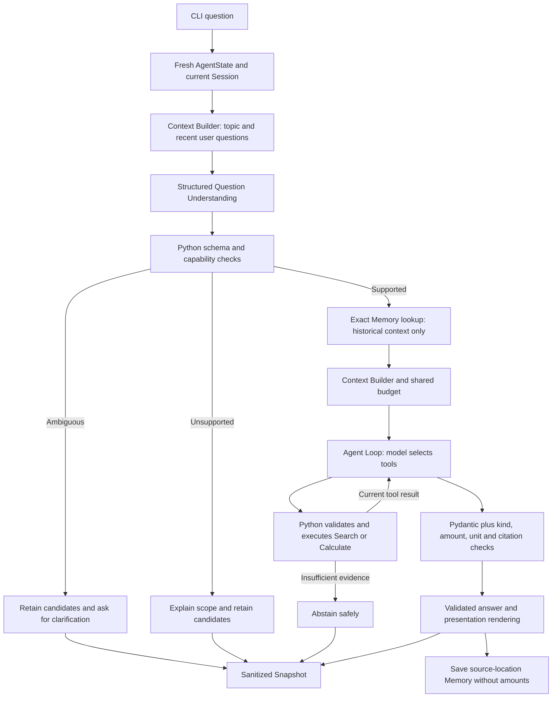

# Financial Research Agent

A small teaching agent that retrieves local financial-report evidence, performs Decimal arithmetic, and validates structured answers against the evidence. `financial_agent.py` is the unified CLI. Earlier lesson demos remain available and reuse the existing tools and validation logic.

## Start here: English presentation demo

From this directory in Windows PowerShell:

```powershell
.\.venv\Scripts\python.exe -B -X utf8 financial_agent.py --demo-en
```

This is an **Offline Demo**, not a live GPT session. Fake Responses supply scripted model decisions; amounts come from real local Retrieval and Decimal calculation. The English presentation layer displays only results that passed the existing Citation and Evidence Validation.

The four questions demonstrate:

1. CVS Q2 2025 consolidated revenue: **$98.9 billion**.
2. The same quarter in 2024: **$91.2 billion**.
3. An ambiguous year-over-year follow-up: ask which periods to compare.
4. An explicit Q2 2025 versus Q2 2024 comparison: **approximately $7.7 billion** more revenue.

These are expected results from rounded earnings-presentation figures, not hardcoded display values. Answers include the actual source citation and PDF page. Questions, answers, clarification, errors, and terminal notices are in English. Sensitive error details are hidden. This mode rejects `--live` and `--confirm-paid-api` and does not read an API key.

The English branch is `oli2/english-demo`. The previously evaluated version remains on `oli2/final-integration` at `91eb62b01d4cfd15ccda20083853205d340b74cb`. Do not describe the English branch as the exact version used in that historical evaluation.

### Language and compatibility

Documentation, code comments, evaluation report headings, and the English presentation demo are in English. Original Chinese test questions, frozen datasets/labels, legacy answer formats, internal unit identifiers, and the original Chinese `--demo` are intentionally preserved. Report traces retain original questions and answers instead of translating evidence or changing grading inputs. This is an English-facing project with bilingual regression data, not a removal of every Chinese string from the source tree.

### Other entry points

```powershell
# Original Chinese demo: Fake Responses and real local tools, no API cost.
.\.venv\Scripts\python.exe -B -X utf8 financial_agent.py --demo
# Interactive offline fixtures; enter exit to quit.
.\.venv\Scripts\python.exe -B -X utf8 financial_agent.py
# Full offline regression suite.
.\.venv\Scripts\python.exe -B -X utf8 -m unittest discover -q
# Offline validation of the 8-scenario, 11-turn evaluation runner.
.\.venv\Scripts\python.exe -B -X utf8 -m evaluation.final_runner
```

Default interactive offline mode accepts only its listed fixture questions. It demonstrates orchestration, not natural-language understanding, and never silently calls a paid API. The original interactive and live answer rendering remains Chinese.

On a new machine, create `.venv` with `python -m venv .venv`, then install dependencies:

```powershell
.\.venv\Scripts\python.exe -m pip install -r requirements-openai.txt
```

The repository's local Chunking index and public CVS source metadata must also be available. Use the project virtual environment; system Python may lack retrieval dependencies.

Only after explicit approval for paid execution:

```powershell
.\.venv\Scripts\python.exe -B -X utf8 financial_agent.py --live --confirm-paid-api
```

Live mode uses `gpt-6.1-sol`, a 30-second timeout, and SDK `max_retries=0`. It reads `OPENAI_API_KEY` only when both live switches are present and never prints it. GPT interprets the question and selects tools/final fields. Python validates scope and budgets, executes tools, verifies evidence, and renders the answer. The original Rule-based Parser remains in `session_demo.py`; the unified LLM entry point does not call it.

## Architecture



### Three distinct outcomes

- **Ambiguity:** "that company" could refer to CVS or UNH. Ask for clarification and retain `pending_companies` and `pending_question`; do not execute financial tools.
- **Insufficient evidence:** a supported query type, such as Amazon Q2 2025 or CVS Q2 2023 revenue, cannot be verified locally. Search, then abstain without borrowing an old amount.
- **Unsupported capability:** intent is clear but required capabilities are absent, such as explicit multi-company requests, net income, percentage growth, or cross-quarter comparisons. Two companies in a question do not automatically imply ambiguity. Retain candidates/periods so the user can select one company in a new task.

Verified financial coverage is **CVS consolidated revenue for Q2 2025 and Q2 2024**, plus the increase between those periods. Other companies/periods may reach Search, but evidence is not guaranteed. Standalone arithmetic remains available through `api_demo.py --scenario calculate`; the unified language interface focuses on revenue lookup and year-over-year amount comparisons.

Unsupported features include multi-company analysis, other metrics, percentages, automatic downloads, trading, automatic task recovery, and unrestricted long-term conversation history.

## Agent Loop and Structured Outputs

1. Python sends the question, selected context, tool definitions, and output schema.
2. The model returns `function_call` with a tool name and arguments.
3. Python checks the tool whitelist, arguments, and numerical basis, then executes the existing function.
4. Python returns `function_call_output` with the same `call_id`. Required response items, including reasoning items, remain paired with the tool trace.
5. The model returns structured final fields. Pydantic checks the schema; Python checks kind, amount, unit, and citation against this task's actual tools before rendering an answer.

`FinancialResearchResult` requires `kind`, `value`, `unit`, and `citation`. Generic kinds are search, compare, calculate, and insufficient. Value is a decimal string such as `"98.9"`, or null; a JSON number is not interchangeable. Citation IDs use the S1/S2 format, or null. Original Chinese wire values for USD billions and unitless arithmetic remain unchanged; the English demo translates their presentation only after validation.

Insufficient results require null value/unit/citation. Pure arithmetic uses the existing unitless identifier and null citation. Missing/extra fields and wrong types fail validation. Pydantic generates `text.format.schema` and validates received data with the same model; local cross-field validators also run in Python.

**Schema Validation** checks shape, types, allowed values, and cross-field constraints. **Evidence Validation** checks agreement with retrieved facts and calculations. `"999"` and `"S9"` can have valid formats and still be factually wrong. Fluent wording and schema compliance do not prove financial accuracy.

### Task-specific output kind guardrail

Historical L04.2 failed in final `render_answer()` validation after Understanding identified compare, Search returned 98.9/91.2, and Calculate returned 7.7. The rejected JSON was not retained; its actual kind and the model's reason remain unknown. Tool-name/answer-kind confusion is a hypothesis, not a proven cause. Confirmed gaps were a broad four-kind schema, unclear task/tool distinction in instructions, and logging only after successful validation.

`final_result_model(kind)` specializes the Pydantic model with one Literal. `final_format_for(kind)` derives its schema and converts single-value const to one-value enum. A compare task requests `"kind": {"type": "string", "enum": ["compare"]}` and validates against that specialized model locally. The generic contract remains available. Selection follows the validated task and stays constant across tool rounds; each task starts fresh history.

Calling `calculate` during a revenue comparison does not make the answer kind `calculate`. Python still verifies evidence, amount, unit, and citation. Wrong results are never silently rewritten or retried. Missing Search evidence follows the existing early-abstention path.

`AgentState.final_validation_diagnostic` records expected kind, safely recognized actual kind, bounded structured summary, failed rule, sanitized schema issues, and stage. Rules distinguish valid JSON, schema contract, task kind, amount, citation, unit, and evidence consistency. An amount is shown only if it matches approved tool data; arbitrary strings, unknown field names, nested data, and other amounts are masked. No raw response, credentials, headers, hidden reasoning, or arbitrary Pydantic input/context bodies are logged. Diagnostics need no additional API request.

The lesson's original report is `artifacts/evaluation/llm_live_v1/live_20261111T032436Z/report.json`. Its targeted retest remains available:

```powershell
.\.venv\Scripts\python.exe -B -X utf8 llm_session_demo.py --compare-retest
# Only after approval for a new paid retest:
.\.venv\Scripts\python.exe -B -X utf8 llm_session_demo.py --compare-retest --live --confirm-paid-api
```

It reads the prior L04.1 question/outcome as labeled replay context, then asks the original L04.2 question meaning "I mean Q2 2025 compared with Q2 2024." It does not restore State, reuse evidence, rerun clarification via API, or execute the remaining five turns. A new State runs Understanding, Search, Calculate, and final response: at most 4 requests, 12,000 tokens, and 1,024 output tokens per request. The saved local report must exist. Historical live acceptance belongs to the version actually tested; new offline checks alone cannot establish live compatibility.

## AgentState and budget controls

`AgentState` groups one task's in-memory progress. `run_agent()` still returns an answer string; callers can supply a fresh State to inspect success or failure:

```python
from api_demo import AgentState, StopAgent, run_agent
from mock_responses import MockClient

state = AgentState()
try:
    answer = run_agent(MockClient("compare"), state=state)
except StopAgent:
    print(state.failure_stage, state.error)
print(state.status, state.api_request_count, state.tool_call_count)
print(state.input_tokens, state.output_tokens, state.total_tokens)
```

- `user_question` and `history` retain the question, successful calls, results, and validated final messages. `evidence` holds retrieved amounts/citation; `calculation` holds arithmetic output.
- Request counts increase before sending; tool counts increase before validation/execution. Failed attempts count.
- Token fields accumulate returned Usage. A failed request without Usage leaves cost unknown, not necessarily zero.
- Status moves pending -> running -> completed/failed. `stage` marks current work; `pending_tool_call` stores name, arguments, and call ID before execution.
- Success clears the pending call. Failure retains it and prior successful history/evidence, with `failure_stage` and a safe error. External exception bodies are hidden.
- `final_answer` stores the validated outcome. Insufficient evidence is a normal completed refusal. State survives a raised exception while the caller holds it, but disappears at process exit. Clients, credentials, and environment variables are not State fields.

In the basic compare Fake fixture, Search leaves 1 request / 1 tool / 120 simulated tokens; Calculate leaves 2 / 2 / 240; final validation leaves 3 / 2 / 360, with input 300 and output 60. These are simulated Usage figures, not costs.

The unified CLI shares a process-wide cap of **32 requests / 30,000 total tokens**. Each task allows **4 requests / 12,000 tokens / 5 tool rounds**, with **1,024 output tokens per request**. Understanding and the financial loop share the task budget. Counts cannot reset to bypass limits. API, budget, schema, tool, or persistence errors stop the session without automatic retry.

Earlier `run_agent()` defaults remain 6 requests / 5 tool rounds; `api_demo.py` smoke tests narrow this to 3 requests. Before requesting, Python reserves a conservative UTF-8 byte-based input estimate plus a margin and maximum output; afterward it accounts for actual Usage. This client control can stop early and is not a server-enforced dollar limit. Already incurred charges cannot be undone.

## Session and question understanding

Session retains the confirmed company, metric, year/quarter, pending candidates/corrections, and `deque(maxlen=2)` recent turns. Each turn stores question, resolved question, answer, task ID, and outcome, not State or complete tool history. Questions are bounded to 300 characters and stored answers to 1,500.

### Original Rule-based baseline

```powershell
.\.venv\Scripts\python.exe -B -X utf8 session_demo.py
.\.venv\Scripts\python.exe -B -X utf8 session_demo.py --interactive
```

This offline lesson uses narrow Chinese parsing rules and Fake Responses. It never reads a key, persists Session, or automatically reads/writes Snapshots. Explicit fields update the topic; omitted fields inherit it. "Last year" is relative to the discussed year, not today's date. `ResearchQuery` builds canonical Chinese questions and English search queries from fields rather than mapping every follow-up to CVS.

A CVS Q2 2025 query retrieves 98.9. A follow-up about the increase inherits company/metric/period, creates new State, searches again, and subtracts 91.2 to obtain approximately 7.7. Company/period switches update the topic even without evidence. Missing or ambiguous inputs request clarification without a simulated request or tool; State remains pending. Partial confirmed fields can be retained for a later correction.

The baseline accepts ticker-style company identifiers, selected aliases, explicit `YYYY Qn` periods, and limited lookup/comparison/correction phrases. Unknown expressions, multiple companies/periods, unsupported metrics, percentages, and quarter-over-quarter requests trigger clarification in this older lesson. That is a baseline limitation, not the integrated CLI's scope classification. Retrieval is CVS-specific; a CVS chunk returned for another company cannot pass the outer scope check. The older offline Session has per-task budgets but no cross-task spending budget.

### LLM-based understanding

```powershell
.\.venv\Scripts\python.exe -B -X utf8 llm_session_demo.py
# Only after approval for this paid scenario:
.\.venv\Scripts\python.exe -B -X utf8 llm_session_demo.py --live --confirm-paid-api
```

`QuestionUnderstanding` requires company, metric, period, comparison_period, intent, needs_clarification, and clarification_question. Periods contain year/quarter; intent is search, compare, or unsupported. Amounts and extra fields are forbidden.

GPT receives the current question, Session topic, and recent user questions, without old answers, tool results, report text, or amounts. Understanding has no tools. Python validates structure and supported semantics without silently rewriting unsupported intent. Fresh State runs `prepare_query` and the existing loop through shared request/Usage accounting. Interpretation JSON never becomes evidence. Before GPT, Python checks length/configuration/budget, not the Rule-based Parser.

The original three-turn lesson asks for Q2 2025, the same quarter last year, and then an ambiguous increase. Expected behavior is 98.9, 91.2, then clarification rather than silently jumping back to 2025. An explicit Q2 2025 versus Q2 2024 correction starts new Search and Calculate calls. The standalone CLI stops at clarification/error and never answers its own clarification. Its maximum across three task budgets is 12 requests / 36,000 tokens, with 7 requests expected on the scripted path. The unified CLI adds the stricter shared process cap above.

Fake interpretations validate wiring only. Pydantic cannot prove that GPT resolved every reference correctly. Live mode does not fall back to Fake Responses or another model after errors.

## Deterministic Context Builder

`build_context()` runs before each financial-loop request and returns `ContextPlan`: decision, input_items, estimated_input_tokens, selected_task_ids, omitted items, message, and memory_task_ids. Decisions are ready, clarify, budget_stop, or invalid_context; input is empty when sending is unsafe.

Required context includes confirmed topic, applicable corrections, current canonical question, and this task's complete response items/tool results. At most one matching completed prior topic is projected to company/metric/period/intent as optional context. Old amounts, answers, citations, raw questions, and tool traces do not become new evidence. Topic summaries are ordinary user data marked `not_financial_evidence`, not system instructions. Original instructions/tools/schema are still included.

The builder does not mutate Session, State, Evidence, or original History. It requires the correct initial question, unique call IDs, calls preceding matching results, and no outstanding/orphaned calls. It preserves assistant and reasoning items, including encrypted content, and the original one-tool-per-round restriction. Missing, duplicate, or reordered records stop execution; budget trimming never breaks a tool pair.

The default context cap is 12,000 conservative estimate units, not an official context-window size or exact tokenizer count. The estimate is UTF-8 request bytes plus 1,024, including schema/tools. It also checks used tokens + estimated input + maximum output against the task budget. Optional history is removed first; oversized required content stops before a request is counted. A smaller limit can be passed with `run_turn(session, question, context_budget=5000)`.

`context_demo.py` prints Session, ContextPlan, and actual Fake input while moving from CVS to UNH to Amazon, including corrections/ambiguity. It uses real local Search, no Live Client, no persisted conversation, and no Snapshot loading. Deterministic selection is not LLM language understanding.

## Local long-term Memory

`long_term_memory.py` provides `MemoryRecord`, `save_memory()`, and `search_memory()`. Schema version `"1"` stores company, metric, year/quarter, source URL/page, last verified UTC time, and Snapshot Task ID. It excludes amounts, full answers, conversations, tool calls, and instructions.

Standalone storage is `artifacts/research_memory/<company>/<metric>/<year>Q<quarter>/<snapshot_task_id>.json`, ignored by Git. Tasks remain separate; resaving a task atomically replaces its file only. Memory and Snapshot share strict JSON reading/atomic writing through `json_storage.py`.

Search uses exact company/metric/year/quarter matching, not embeddings, fuzzy inference, or network requests. It neither reads linked Snapshots nor resumes tasks. Returned records have `context_kind="historical_context"` and `requires_revalidation=true`. Records at least seven days old, or with future timestamps, are stale. This teaching policy does not certify recent records as correct.

Limits: 4 KiB per file, 20 files/records per topic, 3 returned records. Sort by non-stale first, newest verification time, then task ID. Capacity errors stop without deleting history. Corrupt matching records stop lookup; unrelated company directories are not read.

Older Session lessons opt in explicitly:

```python
from long_term_memory import MEMORY_DIR
result = run_turn(session, question, memory_directory=MEMORY_DIR)
```

A new task searches Memory once. Context Builder rechecks topic/fields/markers and includes at most 3 records / 1,800 serialized characters. It drops whole records instead of truncating URLs or markers and removes optional history before current tool pairs. Memory stays ordinary data: URLs are not executed and records are never copied to `AgentState.evidence`. Schema validity is not source authenticity. New financial amounts always require Search and Evidence Validation.

### Cross-process lesson

```powershell
# Process 1: Fake decisions, real retrieval; save Snapshot and CVS topic, then exit.
.\.venv\Scripts\python.exe -B -X utf8 memory_demo.py save
# Process 2: read-only CVS/UNH memory search, without importing Agent or SDK.
.\.venv\Scripts\python.exe -B -X utf8 memory_demo.py search
# Optional new task: historical context, but fresh retrieval and validation.
.\.venv\Scripts\python.exe -B -X utf8 memory_demo.py ask --company CVS
```

One initial save yields one CVS match and zero UNH matches. Repeated saves create distinct tasks; at most three are returned. Use `search --company UNH` for one company. `ask` creates a new ID without resuming calls or automatically saving Memory. `save` records verification time only after evidence succeeds. None has a Live option.

Snapshot records what happened in one task. Memory records which topic was researched and where its source was found. Memory Retrieval finds related records; Context Builder decides what fits; Evidence Validation determines whether this answer is supported.

## State Snapshot persistence

```python
from state_snapshot import save_state_snapshot, load_state_snapshot
path = save_state_snapshot(state)  # Explicit save, not automatic checkpointing.
record = load_state_snapshot(path)  # Read-only summary, not resumable AgentState.
print(record.status, record.final_answer)
```

Standalone snapshots use `artifacts/state_snapshots/<task_id>.json`; integrated snapshots/Memory use `artifacts/financial_agent/snapshots` and `artifacts/financial_agent/memory`. These are Git-ignored. Protect custom directories separately.

Schema version `"1"` stores task ID, question, status/stage, tool/API counts, input/output/total Usage, final answer, and failure stage. A field whitelist excludes full history, reasoning, report text, Evidence, tool arguments, clients, credentials, and raw errors. Validated public answers still contain amounts/citations. A whitelist cannot identify all sensitive free text; private questions/reports need separate storage review.

The unified CLI stores canonical queries and validated public answers, not raw user questions or clarification text. Successful tool details remain in memory after failure; Snapshot stores the failure stage, not raw tool arguments.

Writes use a same-directory temporary file, flush, fsync, close, then atomic `os.replace()`. Failure before replacement preserves the old file; normal exceptions clean temporary files. Forced termination may leave `.tmp` files but not partially published targets. This does not guarantee recovery under every hardware power-loss condition.

Reads reject truncated JSON, bad encoding, duplicate keys, missing/extra fields, wrong types, incompatible versions, files over 64 KiB, and inconsistent state/token totals. Errors hide contents. Returned Pydantic records and Usage objects are immutable.

```powershell
# Process 1: local tools and Fake Responses, save and exit.
.\.venv\Scripts\python.exe -B -X utf8 snapshot_demo.py save --scenario compare
# Process 2: substitute the printed ID; read only, without tools or SDK.
.\.venv\Scripts\python.exe -B -X utf8 snapshot_demo.py read "artifacts\state_snapshots\<task_id>.json"
```

Expected saved results: approximately 7.7 billion (98.9 minus 91.2), PDF page 6, completed status, 2 tools, 3 simulated requests, Usage 300 input / 60 output / 360 total.

**Loading is not safe task recovery.** Summaries omit execution context, do not rerun evidence checks, and may have been edited. A crash between tool execution and result recording leaves uncertainty about whether repeating a call is safe. Recovery needs execution confirmation, duplicate prevention, and remaining-budget handling. Loading never invokes `run_agent()` or replays tools.

Snapshot and Memory writes are individually atomic, not a cross-file transaction. Failed Memory writes can leave valid Snapshots; the CLI reports persistence failure and stops. This is single-user teaching storage without database transactions or concurrent-edit merging.

## Evaluation and reproducibility

English publication validation: **165 offline tests passed**, including the preserved Chinese demo and English presentation tests. The English CLI was also run directly and its output checked for Chinese characters. The original offline benchmark remained **16/18 scenarios** across 25 turns, with its known Rule-based capability probes unchanged. No paid API request was made for this presentation/documentation update. Historical reports were not overwritten.

Frozen datasets remain unchanged: `financial_research_v1` has 18 scenarios; `llm_live_development_v1` has 8 scenarios / 11 turns. See [evaluation documentation](evaluation/README.md) for denominators/cases/cohorts and [the historical integration record](FINAL_VALIDATION.md) for that phase's offline results.

The final runner uses the CLI's `integrated_turn()`. Cases isolate Session/storage; turns share relevant context but get new States. Reports record understanding, tools, citations, failures, and Usage. Gold never enters model prompts. Tool results are checked before entering State/context: finite decimal strings, unit, citation, title, page, and URL. Amounts come from the local parser, not gold.

For a separately approved new evaluation version, first make a clean feature-branch commit:

```powershell
.\.venv\Scripts\python.exe -B -X utf8 -m evaluation.final_runner --freeze
# Only after approval for the new paid run:
.\.venv\Scripts\python.exe -B -X utf8 -m evaluation.final_runner --live --confirm-paid-api
```

The existing manifest is `artifacts/evaluation/final_integration_v2/frozen_version.json`; earlier records/reports remain unchanged. It records commit, source/tool hashes, Retrieval inputs/dependencies, Python/SDK/Pydantic/tiktoken/markdown-it-py versions, model configuration, budgets, and datasets. Paid mode checks a clean tree and exact agreement before reading a key. Do not reuse or overwrite an old freeze after edits. A model identifier is not a server-weight snapshot and cannot guarantee identical future output.

The full-suite plan expected approximately 28 requests, capped at 32 / 30,000 tokens, 4 requests per task, and 1,024 output tokens per response. Historical planning used Standard input $2/million and output $10/million: roughly $0.05-$0.10 normally, or $0.30 if all budgeted tokens used the higher rate. These are dated estimates, not current-price guarantees or server-enforced dollar limits. Missing Usage leaves cost unknown. The recorded [pricing source](https://developers.openai.com/api/docs/models/gpt-6.1-sol) was checked on 2026-11-10; recheck before later paid runs.

L05's frozen label is `clarify`; the integrated agent classifies the explicit two-company request as `unsupported`. Preserve the mismatch and review scope separately instead of changing gold. These are development/regression questions, not independent out-of-sample evaluation. Fake scores verify orchestration/grading, not GPT understanding. Do not merge different code versions into one score.

## Data and API boundaries

- No automatic retries, model fallback, trading, or external writes. Live errors stop safely.
- Only approved public CVS revenue values, units, citation, title, page, and URL can leave local Retrieval. Full PDFs/report bodies are not uploaded.
- Parsing, Chunking, and Retrieval stay local. `store=False` controls Response storage; school data policies still apply.
- Fake Usage must never be presented as real API cost.
- Legacy demos and Chinese evidence contracts remain intact; the English demo is a presentation adapter, not a new research engine.

For standalone arithmetic, run `api_demo.py --scenario calculate` offline. A paid test requires approval and both live flags; normally it uses two Responses requests. Permission, quota, and model errors stop without retries or model switches.

References: [Function Calling](https://developers.openai.com/api/docs/guides/function-calling), [Structured Outputs](https://developers.openai.com/api/docs/guides/structured-outputs), and [Responses API](https://developers.openai.com/api/reference/resources/responses/methods/create).
