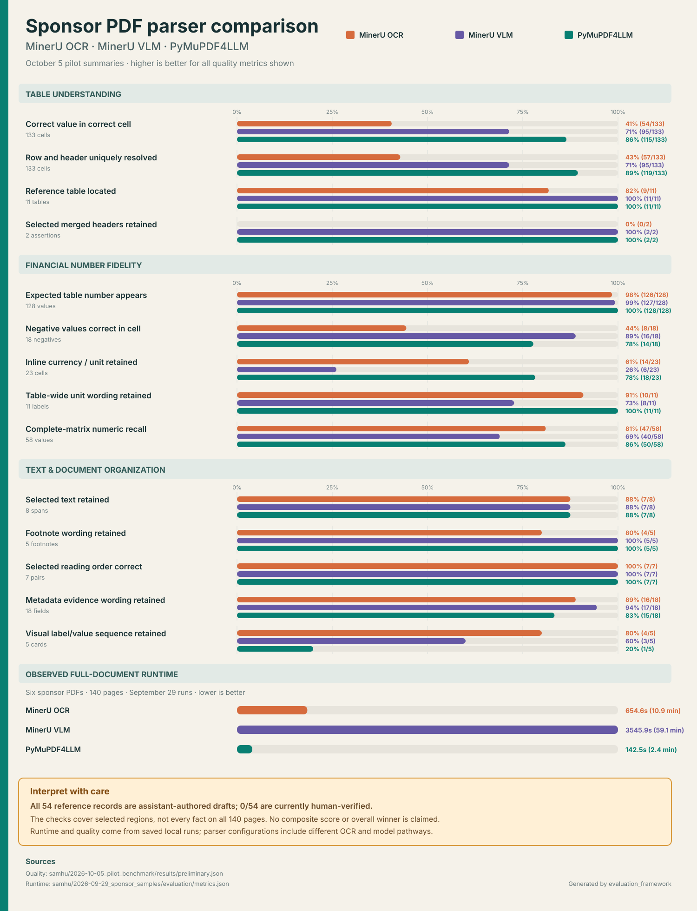

# MinerU and PyMuPDF4LLM comparison



The chart compares both tested MinerU configurations—OCR pipeline and local
VLM—with PyMuPDF4LLM. Treating “MinerU” as one system would hide substantial
differences between those paths.

## Main findings

- **PyMuPDF4LLM leads the expanded table checks:** 115/133 correctly associated
  values, 119/133 resolved row/header locations, and 50/58 complete-matrix
  numeric recall.
- **MinerU VLM is strongest on negatives:** 16/18 negative values versus 14/18
  for PyMuPDF4LLM and 8/18 for MinerU OCR. It also retains both selected merged
  headers.
- **MinerU OCR retains most page-level values but struggles with associations:**
  126/128 expected numbers appear, while only 54/133 values are recovered under
  the correct row and header.
- **PyMuPDF4LLM has the strongest selected-span character fidelity and observed
  runtime:** 2/1,211 character errors and 142.5 seconds for the 140-page batch.
  MinerU OCR took 654.6 seconds and MinerU VLM took 3,545.9 seconds.
- **No parser wins every category:** MinerU OCR leads the small visual-sequence
  check, MinerU VLM leads negative-value accuracy and metadata-evidence retention,
  and PyMuPDF4LLM leads most table-association and unit checks.

## Important limitation

These are preliminary development results. All 54 reference records are
assistant-authored drafts and currently **0/54 are human-verified**. The selected
checks cover 18 of 140 pages and do not establish document-wide accuracy. The
chart therefore does not compute a composite score or declare an overall winner.

## Sources

- Quality metrics: [`../../samhu/2026-10-05_pilot_benchmark/results/preliminary.json`](../../samhu/2026-10-05_pilot_benchmark/results/preliminary.json)
- Metric definitions and visual reviews: [`../../samhu/2026-10-05_pilot_benchmark/review/`](../../samhu/2026-10-05_pilot_benchmark/review/)
- Runtime results: [`../../samhu/2026-09-29_sponsor_samples/evaluation/metrics.json`](../../samhu/2026-09-29_sponsor_samples/evaluation/metrics.json)

Regenerate the SVG after the underlying results change:

```bash
python3 people/yujiezhu/evaluation_framework/generate_comparison_chart.py
```
